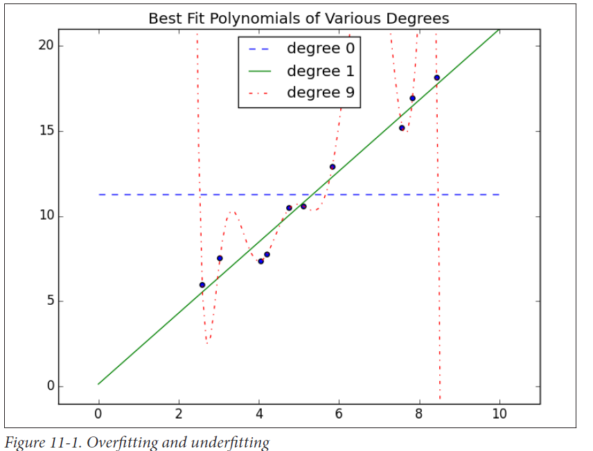

# Chapter 11: Machine Learning

## What is Machine Learning?

Q. Give few examples of Machine Learning applications?

## Overfitting and Underfitting

Q. Explain what is overfitting and underfitting in this figure. 

Q. What do you understand by data-splitting?

## Correctness

Q. Construct an example where if the model is predicting something with 99% accuracy, it is useless.

Q. Create a scenario of

- True positive
- False positive
- False negative
- True negative

Q. Construct an example of a *confusion matrix*.

Q. What is *precision*? Give example.

Q. What is *recall*? Give example.

Q. What is *F1 score*? 

## The bias-variance Trade off

Q. Explain what did you understand about the Bias-Variance tradeoff. 

## Feature Extraction and Selection

# Chapter 12: k-Nearest Neighbors