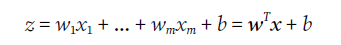
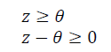
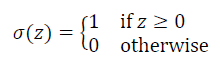

Q. We will study what two ML algorithms for classification in this chapter?

A. Perceptron, Adaptive Linear Neurons

Q. What will we train the perceptron to do?
A. Classify different flower species.

Q. Explain: 

Q. Exercise: Create an example of 2d input perceptron. With code.

Q. Recall the perceptron algorithm?

Q. How are the updates $\delta$ calculated?

Q. Whats a learning rate?
